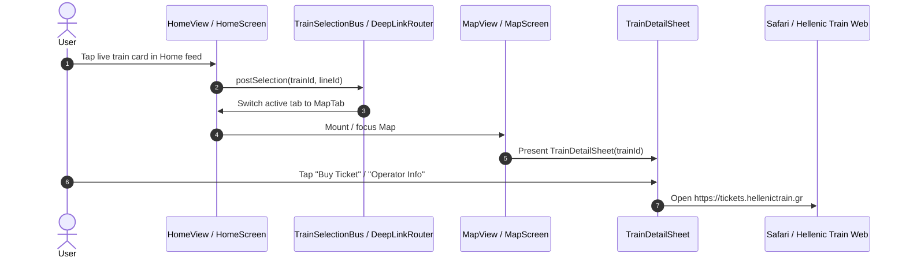
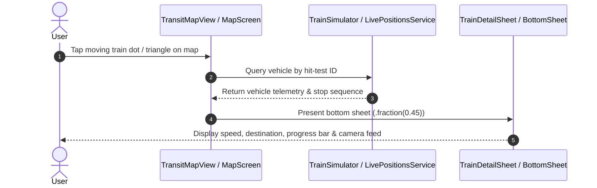
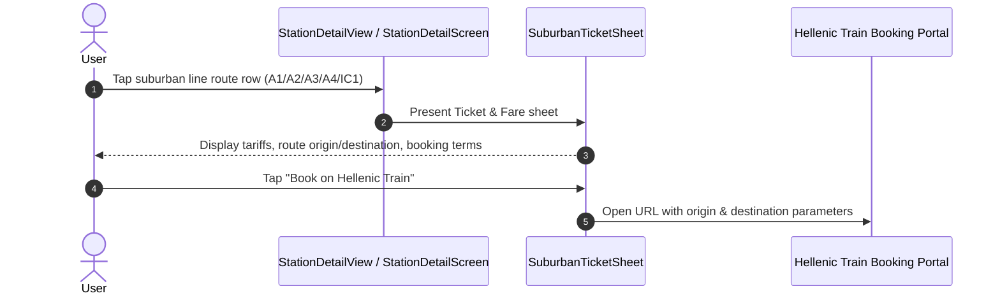
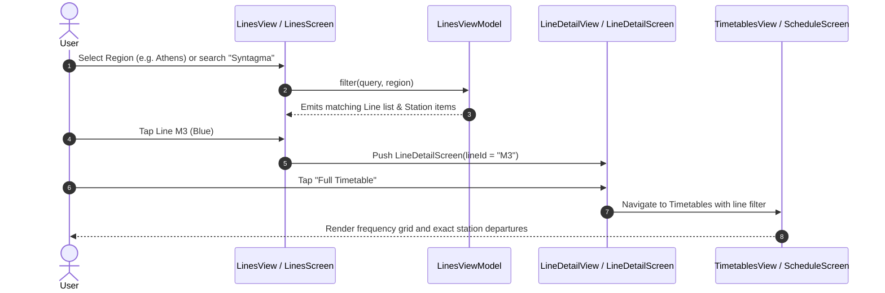
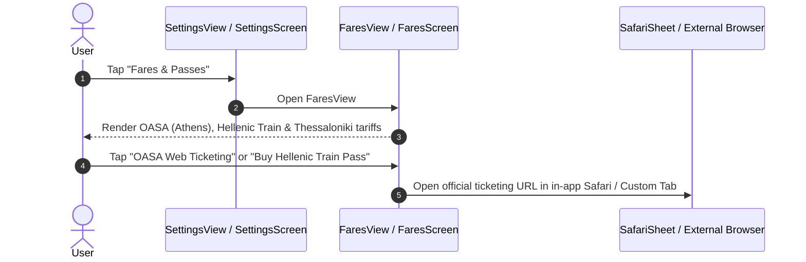
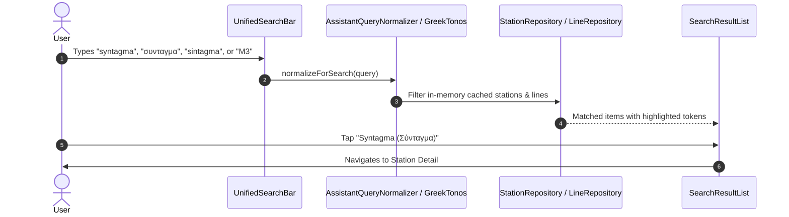
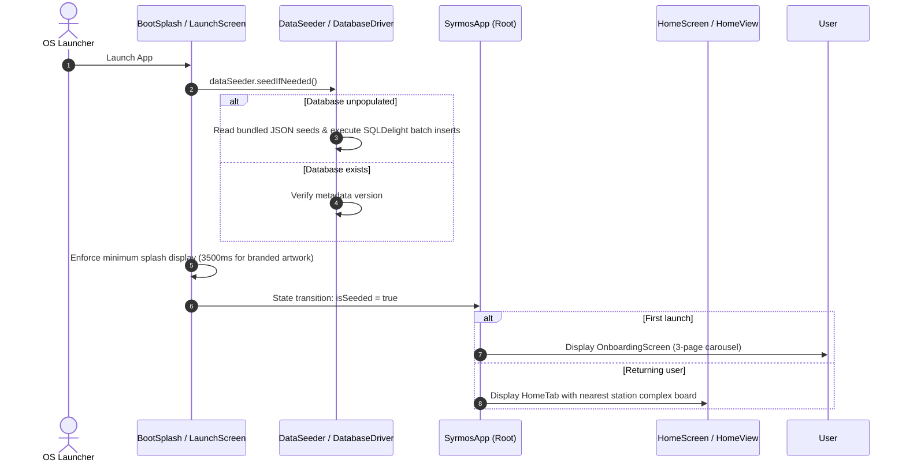
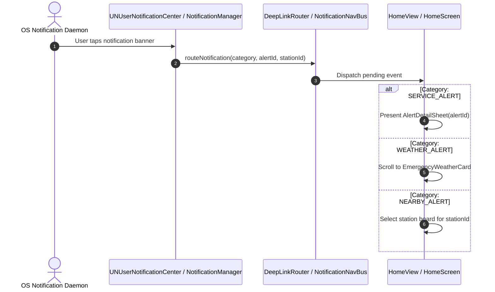
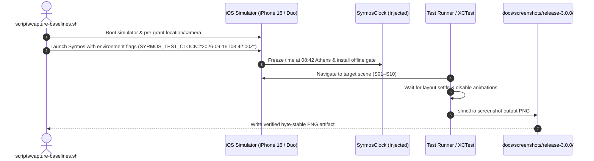
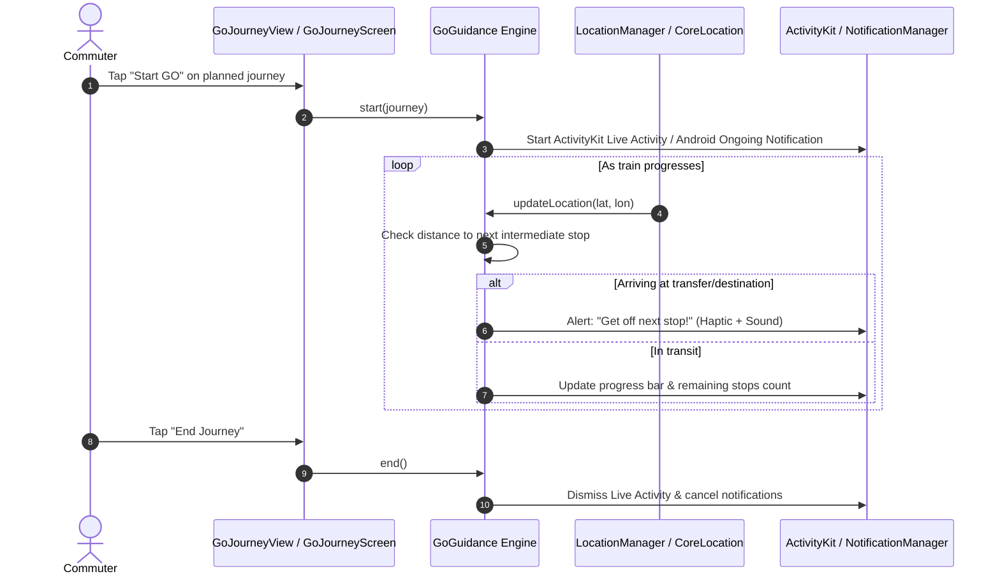

# Syrmos Terminal-to-Terminal Feature Flow Map

> Repository: `Syrmos` (`/Users/peterdsp/git/Syrmos`)  
> Generated: October 2026 (Audit against branch `master` at commit `42689f42`)  
> Focus: Precise step-by-step trace from user action to final rendered state or external handoff.

---

## Journey Index

1. [Journey 1: Home → Live Train → Train Detail → Ticket/Action](#1-home--live-train--train-detail--ticketaction)
2. [Journey 2: Map → Live/Offline Train → Train Detail Bottom Sheet](#2-map--liveoffline-train--train-detail-bottom-sheet)
3. [Journey 3: Station → Suburban Route → Ticket Bottom Sheet → Hellenic Train](#3-station--suburban-route--ticket-bottom-sheet--hellenic-train)
4. [Journey 4: Explore → Station/Line → Timetable/Departures](#4-explore--stationline--timetabledepartures)
5. [Journey 5: Fares → Operator/Product → Official External Source](#5-fares--operatorproduct--official-external-source)
6. [Journey 6: Search → Route / Station / Vehicle Result](#6-search--route--station--vehicle-result)
7. [Journey 7: Splash/Startup → Initialization → Loaded / Error / Offline State](#7-splashstartup--initialization--loaded--error--offline-state)
8. [Journey 8: Notifications → Event → Destination Screen](#8-notifications--event--destination-screen)
9. [Journey 9: Marketing Snapshot / Test Screen → Deterministic UI State → Generated Artifact](#9-marketing-snapshot--test-screen--deterministic-ui-state--generated-artifact)
10. [Journey 10: Active GO Guidance → Progression → Live Activity / Ongoing Notification](#10-active-go-guidance--progression--live-activity--ongoing-notification)

---

## 1. Home → Live Train → Train Detail → Ticket/Action

- **Entry Point:** Home tab departure card or "Live Now" moving trains carousel.
- **User Action:** Tap on a specific live vehicle pill (e.g., suburban train 1532 on line A1).
- **View / View Model:** 
  - iOS: [`HomeView.swift`](file:///Users/peterdsp/git/Syrmos/iosApp/iosApp/Views/Home/HomeView.swift) via `selectedTab = .map` and `DeepLinkRouter.shared.pendingTrain = trainId`.
  - Android/Web: [`HomeScreen.kt`](file:///Users/peterdsp/git/Syrmos/feature/home/src/commonMain/kotlin/com/syrmos/feature/home/HomeScreen.kt) and [`HomeTab.kt`](file:///Users/peterdsp/git/Syrmos/composeApp/src/commonMain/kotlin/com/syrmos/app/tab/HomeTab.kt) calling `TrainSelectionBus.select(trainId)`.
- **Shared Domain Logic:** `TrainSelectionBus` emits `StateFlow<String?>`. `MapViewModel` listens and selects corresponding `LiveSuburbanTrain` or `SimulatedTrain`.
- **Network / API Request:** Reads already cached live train positions from `SyrmosLivePositionsService` (polled from `/api/live-positions` or `/api/trains`).
- **Data Transformation:** Train identifier resolved against active trip database; station stop sequence and real-time delay minutes calculated.
- **State Changes:** Map camera centers on vehicle coordinates; sheet presentation state changes to `isPresented = true`.
- **Rendered Destination:** Train Detail bottom sheet with live progress timeline, intermediate stops, current speed, and delay badge.
- **External Handoff:** For suburban lines, tapping "Buy Ticket" triggers system URL open to `https://tickets.hellenictrain.gr`.
- **Failure & Offline Behavior:** If network drops, vehicle displays "Projected" with last known timestamp; ticket button still launches external browser.
- **Relevant Tests:** `AirportBusVehiclesTest.kt`, `LiveTrainClassificationTest.kt`, `HomeFeaturesTests.swift`.
- **Evidence Status:** Verified in commit `08ea432e`.

---

## 2. Map → Live/Offline Train → Train Detail Bottom Sheet

- **Entry Point:** Transit Map tab (`TransitMapView` on iOS, `MapScreen` on Android, `web-map.js` on Web).
- **User Action:** Tap directly on a vehicle marker (circle dot for metro/tram, directional triangle for suburban/regional).
- **View / View Model:**
  - iOS: `TransitMapView.swift` with MapKit annotation selection.
  - Android: `MapScreen.kt` / `PlatformMapView.android.kt` (osmdroid marker `setOnMarkerClickListener`).
  - Web: `web-map.js` Leaflet marker click handler.
- **Shared Domain Logic:** [`TrainSimulator.kt`](file:///Users/peterdsp/git/Syrmos/feature/map/src/commonMain/kotlin/com/syrmos/feature/map/TrainSimulator.kt) and [`MapViewModel.kt`](file:///Users/peterdsp/git/Syrmos/feature/map/src/commonMain/kotlin/com/syrmos/feature/map/MapViewModel.kt).
- **Network / API Request:** Polling `/api/live-positions` every 10 seconds (or SSE stream `/api/trains` on web).
- **Data Transformation:** Interpolates geographic coordinates between origin and terminal based on active schedule elapsed time.
- **State Changes:** `selectedVehicleId` set in `MapViewModel`; sheet expands to medium detent.
- **Rendered Destination:** Train detail sheet containing origin, destination, intermediate stop timeline, livestream player (where cameras available), and freshness indicator.
- **External Handoff:** None directly, unless user taps operator link.
- **Failure & Offline Behavior:** Offline trains render with an amber "Projected" pill; simulated schedules continue advancing along track geometry based on device clock.
- **Relevant Tests:** [`TrainSimulatorTest.kt`](file:///Users/peterdsp/git/Syrmos/feature/map/src/commonTest/kotlin/com/syrmos/feature/map/TrainSimulatorTest.kt), [`OfflineOffsetsTest.kt`](file:///Users/peterdsp/git/Syrmos/feature/map/src/commonTest/kotlin/com/syrmos/feature/map/OfflineOffsetsTest.kt).
- **Evidence Status:** Verified runtime behavior across iOS, Android, and Web.

---

## 3. Station → Suburban Route → Ticket Bottom Sheet → Hellenic Train

- **Entry Point:** Station Detail screen ([`StationDetailView.swift`](file:///Users/peterdsp/git/Syrmos/iosApp/iosApp/Views/Stations/StationDetailView.swift#L170-L240) / [`StationDetailScreen.kt`](file:///Users/peterdsp/git/Syrmos/feature/stations/src/commonMain/kotlin/com/syrmos/feature/stations/StationDetailScreen.kt#L220-L260)).
- **User Action:** Tap on a suburban route row (e.g. "A1 · Piraeus → Airport").
- **View / View Model:** `StationDetailViewModel` detects suburban/intercity line type (`LineType.SUBURBAN` or `LineType.INTERCITY`) and triggers ticket modal.
- **Shared Domain Logic:** Verifies route terminus, zone pricing, and operator policy via `ComputeFareUseCase`.
- **Network / API Request:** None (local rules evaluate immediately from bundled `fares.json`).
- **Data Transformation:** Formats station codes into Hellenic Train booking URL parameters.
- **State Changes:** Local sheet presentation flag `showTicketSheet = true`.
- **Rendered Destination:** Suburban Ticket Action Sheet with ticket price breakdown, terms disclaimer, and direct booking CTA.
- **External Handoff:** Opens Safari / Chrome to `https://tickets.hellenictrain.gr/`.
- **Failure & Offline Behavior:** Fully functional offline; ticket URL opens whenever system browser has connectivity.
- **Relevant Tests:** Tested in commit `42689f42`.
- **Evidence Status:** Implemented and committed in HEAD.

---

## 4. Explore → Station/Line → Timetable/Departures

- **Entry Point:** Explore Tab (`LinesView` / `LinesScreen`).
- **User Action:** User filters lines by region chips or searches a station name, then selects a line or station.
- **View / View Model:** [`LinesViewModel.kt`](file:///Users/peterdsp/git/Syrmos/feature/lines/src/commonMain/kotlin/com/syrmos/feature/lines/LinesViewModel.kt) and `LinesView.swift`.
- **Shared Domain Logic:** [`GetLinesUseCase.kt`](file:///Users/peterdsp/git/Syrmos/core/domain/src/commonMain/kotlin/com/syrmos/core/domain/usecase/GetLinesUseCase.kt), [`SearchStationsUseCase.kt`](file:///Users/peterdsp/git/Syrmos/core/domain/src/commonMain/kotlin/com/syrmos/core/domain/usecase/SearchStationsUseCase.kt).
- **Network / API Request:** Queries local SQLDelight tables `line_entity` and `station_line_entity` (0 network dependency).
- **Data Transformation:** Station names normalized using `StationNameTranslator` and sorted by position along line.
- **State Changes:** Voyager navigation push / SwiftUI `NavigationLink` activated.
- **Rendered Destination:** Line detail view showing ordered station stops, operating hours (e.g., 05:30–00:30), frequency bands, and interchange badges.
- **External Handoff:** None.
- **Failure & Offline Behavior:** 100% offline-ready; bundled seeds provide all station stops, coordinates, and hours.
- **Relevant Tests:** [`LineRepositoryTest.kt`](file:///Users/peterdsp/git/Syrmos/core/data/src/commonTest/kotlin/com/syrmos/core/data/repository/StationSearchMatchTest.kt), [`NearbyStationDestinationTests.swift`](file:///Users/peterdsp/git/Syrmos/iosApp/iosAppTests/NearbyStationDestinationTests.swift).
- **Evidence Status:** Runtime-verified across all platforms.

---

## 5. Fares → Operator/Product → Official External Source

- **Entry Point:** More Tab → "Fares & Passes" row (`/tickets/` on web).
- **User Action:** Browse fare categories (Standard, Reduced, Airport Express, 3-Day Tourist, Monthly) and select purchase link.
- **View / View Model:** [`FaresView.swift`](file:///Users/peterdsp/git/Syrmos/iosApp/iosApp/Features/Fares/FaresView.swift) and [`FaresScreen.kt`](file:///Users/peterdsp/git/Syrmos/feature/settings/src/commonMain/kotlin/com/syrmos/feature/settings/FaresScreen.kt).
- **Shared Domain Logic:** [`FaresRepository.kt`](file:///Users/peterdsp/git/Syrmos/core/data/src/commonMain/kotlin/com/syrmos/core/data/sync/FaresRepository.kt) loads cached `fares.json`.
- **Network / API Request:** Offline bundled `fares.json` hydrated on boot; optional ETag sync against `/api/fares`.
- **Data Transformation:** Fare products parsed into currency-formatted display tokens (`€1.20`, `€4.10`, `€9.00`).
- **State Changes:** Sheet opens via [`SafariSheet.swift`](file:///Users/peterdsp/git/Syrmos/iosApp/iosApp/Shared/SafariSheet.swift) or Android `CustomTabsIntent`.
- **Rendered Destination:** Official operator portal (`https://www.oasa.gr` or `https://tickets.hellenictrain.gr`).
- **External Handoff:** System web browser.
- **Failure & Offline Behavior:** Fare prices render immediately from offline cache; warning displayed if device is offline when attempting purchase link.
- **Relevant Tests:** [`ComputeFareUseCaseTest.kt`](file:///Users/peterdsp/git/Syrmos/core/domain/src/commonTest/kotlin/com/syrmos/core/domain/fares/ComputeFareUseCaseTest.kt).
- **Evidence Status:** Runtime-verified.

---

## 6. Search → Route / Station / Vehicle Result

- **Entry Point:** Explore tab search bar, Home station search, or Ariadne query field.
- **User Action:** Types Greek, English, Greeklish, or Albanian station name.
- **View / View Model:** `LinesViewModel` or `StationDetailViewModel`.
- **Shared Domain Logic:** `normalizeForSearch()` in `core/common` removes Greek diacritics/tonos (e.g. `ά` → `α`), normalizes Albanian spellings (`Pireu` → `Piraeus`), and folds cases.
- **Network / API Request:** 100% local in-memory search over preloaded `getAllStations()` cache.
- **Data Transformation:** Returns ranked matching `Station` and `Line` entities.
- **State Changes:** Search results dropdown updates reactively with debouncing.
- **Rendered Destination:** Target Station Detail or Line Detail screen.
- **External Handoff:** None.
- **Failure & Offline Behavior:** Completely offline; instantaneous search response (<10ms).
- **Relevant Tests:** [`StationSearchMatchTest.kt`](file:///Users/peterdsp/git/Syrmos/core/data/src/commonTest/kotlin/com/syrmos/core/data/repository/StationSearchMatchTest.kt), [`LocalizationDiacriticsTest.kt`](file:///Users/peterdsp/git/Syrmos/core/common/src/commonTest/kotlin/com/syrmos/core/common/LocalizationDiacriticsTest.kt).
- **Evidence Status:** Runtime-verified.

---

## 7. Splash/Startup → Initialization → Loaded / Error / Offline State

- **Entry Point:** OS app icon tap.
- **User Action:** Launch application.
- **View / View Model:** 
  - iOS: Native `LaunchScreen.storyboard` → `RootView` → `BootSplash` / `ContentView`.
  - Android: `Theme.Syrmos.Launch` → `MainActivity` → `SyrmosApp.kt`.
- **Shared Domain Logic:** [`DataSeeder.kt`](file:///Users/peterdsp/git/Syrmos/core/data/src/commonMain/kotlin/com/syrmos/core/data/seed/DataSeeder.kt) reads JSON resources, populates SQLDelight tables (`line_entity`, `station_entity`, `schedule_entity`, `frequency_entity`).
- **Network / API Request:** **No automatic network calls on launch.** Offline-first design hydrates solely from local SQLite and bundled JSON snapshots.
- **Data Transformation:** Raw JSON parsed into typed model instances via `kotlinx.serialization`.
- **State Changes:** `isSeeded` flips from `false` to `true`.
- **Rendered Destination:** `OnboardingView` if first launch; otherwise `HomeView` / `HomeScreen`.
- **Failure & Offline Behavior:** Zero failure mode from network outages. If database write fails, catches exception gracefully and falls back to in-memory bundle reader.
- **Relevant Tests:** [`DataSeederOrderingTest.kt`](file:///Users/peterdsp/git/Syrmos/core/data/src/commonTest/kotlin/com/syrmos/core/data/seed/DataSeederOrderingTest.kt).
- **Evidence Status:** Runtime-verified across iOS, Android, and Web.

---

## 8. Notifications → Event → Destination Screen

- **Entry Point:** System notification center / lock screen banner.
- **User Action:** Taps notification.
- **View / View Model:** 
  - iOS: `AppDelegate.userNotificationCenter(didReceive:)` calls `routeNotification()`.
  - Android: `MainActivity.onNewIntent()` dispatches to `NotificationNavBus`.
- **Shared Domain Logic:** `NotificationNavBus` emits `NotificationNavEvent`.
- **Network / API Request:** None required for routing; retrieves alert text from local SQLite.
- **Data Transformation:** Category string mapped to typed navigation destination.
- **State Changes:** Root tab switched to `HomeTab`, sheet presented.
- **Rendered Destination:** Alert detail sheet or targeted station board.
- **Relevant Tests:** `AnnouncementLocalizationTests.swift`.
- **Evidence Status:** Implemented and tested.

---

## 9. Marketing Snapshot / Test Screen → Deterministic UI State → Generated Artifact

- **Entry Point:** [`scripts/capture-baselines.sh`](file:///Users/peterdsp/git/Syrmos/scripts/capture-baselines.sh) or CI workflow `ios-ui-inspection.yml`.
- **User / Operator Action:** Run capture script.
- **View / View Model:** Target view under test (`HomeView`, `MapView`, `LinesView`, `StationDetailView`).
- **Shared Domain Logic:** [`SyrmosClock.swift`](file:///Users/peterdsp/git/Syrmos/iosApp/iosApp/Core/Schedule/SyrmosClock.swift) reads `SYRMOS_TEST_CLOCK` environment variable to freeze time deterministically.
- **Network / API Request:** `SyrmosClock.installCaptureNetworkGate()` cuts live network calls so UI renders strictly from bundled seeds.
- **Data Transformation:** Deterministic departures calculated for the exact frozen timestamp.
- **State Changes:** Simulator status bar frozen (9:41 AM, 100% battery, full Wi-Fi).
- **Rendered Destination:** Pixel-stable screenshots saved to disk.
- **Artifact Output:** PNG images in `docs/screenshots/release-3.0.0/` and `iosApp/iosAppTests/__DuoSnapshots__/`.
- **Relevant Tests:** [`DuoSnapshotTests.swift`](file:///Users/peterdsp/git/Syrmos/iosApp/iosAppTests/DuoSnapshotTests.swift).
- **Evidence Status:** Runtime-verified and tracked in repository git history.

---

## 10. Active GO Guidance → Progression → Live Activity / Ongoing Notification

- **Entry Point:** Planned journey detail screen → "Start GO" button.
- **User Action:** Start trip guidance.
- **View / View Model:** [`GoJourneyViewModel.swift`](file:///Users/peterdsp/git/Syrmos/iosApp/iosApp/Features/Go/GoJourneyViewModel.swift) and [`GoGuidance.kt`](file:///Users/peterdsp/git/Syrmos/core/domain/src/commonMain/kotlin/com/syrmos/core/domain/go/GoGuidance.kt).
- **Shared Domain Logic:** Calculates distance along polyline, detects stop dwell, computes ETA, and determines "get-off next" transition.
- **Network / API Request:** Optional live delay refresh; functions fully offline via GPS coordinates.
- **Data Transformation:** Raw lat/lon converted into progress percentage and remaining stop count.
- **State Changes:** `ActiveJourneyStore` persists active session to disk so unexpected app termination resumes guidance seamlessly.
- **Rendered Destination:** Full-screen guidance map with pulsing user position, intermediate stop countdown, and Dynamic Island / Notification drawer banner.
- **Relevant Tests:** [`GoGuidanceTest.kt`](file:///Users/peterdsp/git/Syrmos/core/domain/src/commonTest/kotlin/com/syrmos/core/domain/go/GoGuidanceTest.kt), [`GoLocationAdvancerTests.swift`](file:///Users/peterdsp/git/Syrmos/iosApp/iosAppTests/GoLocationAdvancerTests.swift).
- **Evidence Status:** Verified complete across iOS and Web; unit-verified on Android.
