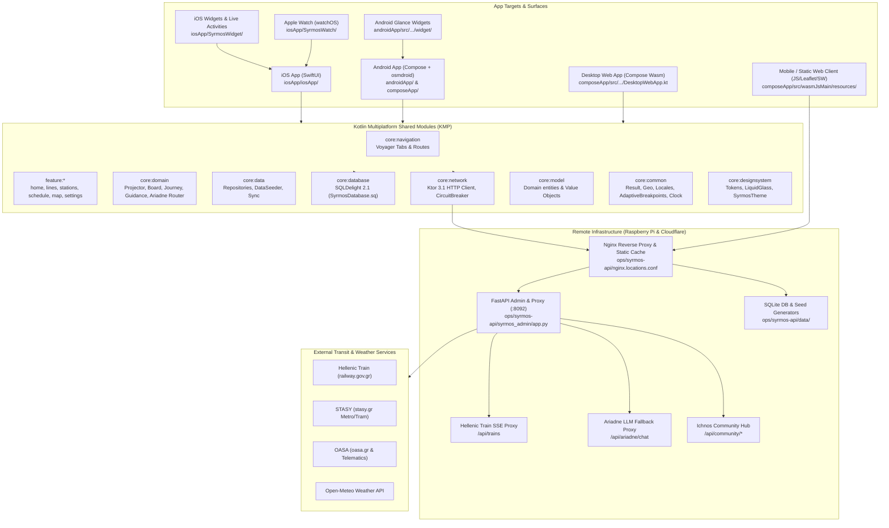
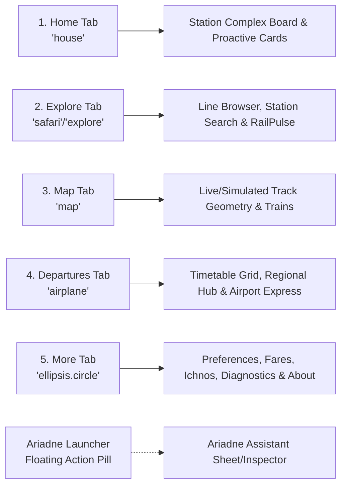
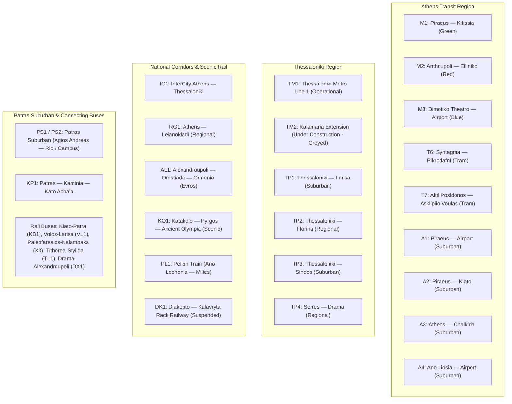

# Syrmos Product Architecture & Implementation Map

> Repository: `Syrmos` (`/Users/peterdsp/git/Syrmos`)  
> Generated: October 2026 (Audit against branch `master` at commit `42689f42`)  
> Focus: Complete platform coverage, screen directory, data models, persistence, external flows, live data, and maturity ledger.

---

## 1. System Architecture Diagram

---

## 2. Platform Targets & Surface Coverage

| Target / Binary | Platform / Technology | Source Root | Status & Maturity |
|---|---|---|---|
| **iOS Main App** | iOS 17.0+ (SwiftUI, MapKit, ActivityKit, App Intents) | [iosApp/iosApp](file:///Users/peterdsp/git/Syrmos/iosApp/iosApp) | Runtime-verified, TestFlight distributed (3.0.0 build 138/epoch) |
| **SyrmosWatch** | watchOS 10.0+ (SwiftUI, TimelineView, AVFoundation TTS) | [iosApp/SyrmosWatch](file:///Users/peterdsp/git/Syrmos/iosApp/SyrmosWatch) | Implemented, builds with app scheme, tested |
| **SyrmosWatchComplications**| WidgetKit (Watch Complications) | [iosApp/SyrmosWatch](file:///Users/peterdsp/git/Syrmos/iosApp/SyrmosWatch/SyrmosWatchComplications.swift) | Implemented, bundled into watch app |
| **SyrmosWidgetExtension** | iOS WidgetKit (Home widgets + Live Activities Dynamic Island) | [iosApp/SyrmosWidget](file:///Users/peterdsp/git/Syrmos/iosApp/SyrmosWidget) | Runtime-verified on simulator/device |
| **Android Main App** | Android 8.0+ / API 26-36 (Jetpack Compose, osmdroid, Koin) | [androidApp](file:///Users/peterdsp/git/Syrmos/androidApp) & [composeApp](file:///Users/peterdsp/git/Syrmos/composeApp) | Runtime-verified on emulator, Play internal (3.0.0 versionCode 233) |
| **Android Glance Widgets**| Jetpack Glance (4 widgets: NextTrain, LiveDepartures, LineStatus, NearMe) | [androidApp/src/.../widget](file:///Users/peterdsp/git/Syrmos/androidApp/src/androidMain/kotlin/com/syrmos/android/widget) | Implemented, WorkManager `SnapshotWorker` wired |
| **Desktop Web App** | Compose Multiplatform for Wasm (Kotlin/Wasm) | [composeApp/.../DesktopWebApp.kt](file:///Users/peterdsp/git/Syrmos/composeApp/src/commonMain/kotlin/com/syrmos/app/DesktopWebApp.kt) | Implemented, builds via `wasmJsBrowserDistribution` |
| **Web Mobile / Standalone**| HTML5 / Vanilla JS / Leaflet / Service Worker v4 | [composeApp/.../resources](file:///Users/peterdsp/git/Syrmos/composeApp/src/wasmJsMain/resources) | Deployed to GitHub Pages (`https://syrmos.peterdsp.dev`) |
| **Web Product Showcase** | Static HTML5 / CSS3 / WebP Responsive Showcase | [composeApp/.../product](file:///Users/peterdsp/git/Syrmos/composeApp/src/wasmJsMain/resources/product) | Deployed at `/product/` |
| **Mobile Web Redirect** | Standalone landing page directing users to App Store / Google Play | [composeApp/.../get-app](file:///Users/peterdsp/git/Syrmos/composeApp/src/wasmJsMain/resources/get-app) | Deployed at `/get-app/` |
| **syrmos-api** | Python 3.11+, FastAPI, Uvicorn, SQLite, Systemd | [ops/syrmos-api](file:///Users/peterdsp/git/Syrmos/ops/syrmos-api) | Deployed on Pi at `api-syrmos.peterdsp.dev` |

---

## 3. Major Screens & Navigation Paths

### 3.1 Primary Navigation Tabs

Both iOS (SwiftUI `TabView`) and Android/Web (Voyager `TabNavigator`) implement a unified 5-tab hierarchy:

### 3.2 Screen Directory & Implementation Matrix

| Screen Name | Route / Path | iOS View | Compose Screen | Description & Key Actions |
|---|---|---|---|---|
| **Home** | `HomeTab` / `/` | [`HomeView`](file:///Users/peterdsp/git/Syrmos/iosApp/iosApp/Views/Home/HomeView.swift) | [`HomeScreen`](file:///Users/peterdsp/git/Syrmos/feature/home/src/commonMain/kotlin/com/syrmos/feature/home/HomeScreen.kt) | GPS nearest station complex board, all-directions cards, live train countdowns, disruptions, emergency weather alerts, quick-track actions. |
| **Station Detail** | `Routes.STATION_DETAIL` (`/station/?id=...`) | [`StationDetailView`](file:///Users/peterdsp/git/Syrmos/iosApp/iosApp/Views/Stations/StationDetailView.swift) | [`StationDetailScreen`](file:///Users/peterdsp/git/Syrmos/feature/stations/src/commonMain/kotlin/com/syrmos/feature/stations/StationDetailScreen.kt) | Full station board, platform departures, mini-map, transfer connections, Hellenic Train ticket action sheet. |
| **Line Detail** | `Routes.LINE_DETAIL` (`/line/?id=...`) | [`LineDetailView`](file:///Users/peterdsp/git/Syrmos/iosApp/iosApp/Views/Lines/LineDetailView.swift) | [`LineDetailScreen`](file:///Users/peterdsp/git/Syrmos/feature/lines/src/commonMain/kotlin/com/syrmos/feature/lines/LineDetailScreen.kt) | Ordered list of stations along line, branch indicators, operating hours, frequency bands, status badge. |
| **Transit Map** | `MapTab` / `/now/` | [`TransitMapView`](file:///Users/peterdsp/git/Syrmos/iosApp/iosApp/Views/Map/MapView.swift) | [`MapScreen`](file:///Users/peterdsp/git/Syrmos/feature/map/src/commonMain/kotlin/com/syrmos/feature/map/MapScreen.kt) | Full-screen interactive map (MapKit on iOS, osmdroid on Android, Leaflet on Web). Real OSM geometry, live vehicle interpolation, station nodes. Tap opens station/train bottom sheet. |
| **Timetables / Departures** | `DeparturesTab` / `/departures/` | [`TimetablesView`](file:///Users/peterdsp/git/Syrmos/iosApp/iosApp/Features/Timetables/TimetablesView.swift) | [`ScheduleScreen`](file:///Users/peterdsp/git/Syrmos/feature/schedule/src/commonMain/kotlin/com/syrmos/feature/schedule/ScheduleScreen.kt) | Timetable search, date-scoped trip schedules (valid_dates), Airport express hub (Metro M3 + Suburban A1 + OASA X93/X95/X96/X97 buses). |
| **Explore / RailPulse** | `ExploreTab` / `/explore/` | [`LinesView`](file:///Users/peterdsp/git/Syrmos/iosApp/iosApp/Views/Lines/LinesView.swift) | [`LinesScreen`](file:///Users/peterdsp/git/Syrmos/feature/lines/src/commonMain/kotlin/com/syrmos/feature/lines/LinesScreen.kt) | Regional line selector (Athens, Thessaloniki, National, Patras), station fuzzy search, RailPulse community conditions feed, submit quick reports. |
| **GO Journey Guidance** | `GoJourneyScreenRoute` | [`GoJourneyView`](file:///Users/peterdsp/git/Syrmos/iosApp/iosApp/Features/Go/GoJourneyView.swift) | [`GoJourneyScreenRoute`](file:///Users/peterdsp/git/Syrmos/composeApp/src/commonMain/kotlin/com/syrmos/app/screen/GoJourneyScreenRoute.kt) | Active trip guidance mode: live countdown to alight, intermediate stop progression, get-off warnings, live activity / ongoing notification sync. |
| **Ariadne Assistant** | Floating overlay / inspector | [`AriadneView`](file:///Users/peterdsp/git/Syrmos/iosApp/iosApp/Features/Assistant/AriadneView.swift) | [`AssistantScreen`](file:///Users/peterdsp/git/Syrmos/feature/home/src/commonMain/kotlin/com/syrmos/feature/home/assistant/AssistantScreen.kt) | Natural-language transit assistant (EN/EL/SQ/IT). Offline deterministic parser first (<0.2s), optional remote LLM fallback. Answers last trains, fares, departures, route options. |
| **Fares Screen** | Settings submenu / `/tickets/` | [`FaresView`](file:///Users/peterdsp/git/Syrmos/iosApp/iosApp/Features/Fares/FaresView.swift) | [`FaresScreen`](file:///Users/peterdsp/git/Syrmos/feature/settings/src/commonMain/kotlin/com/syrmos/feature/settings/FaresScreen.kt) | OASA & Hellenic Train ticket tariffs, passes, student discounts, airport surcharges, and official purchase handoff links. |
| **Leave-By Reminders** | Settings submenu | [`SavedDeparturesBoardView`](file:///Users/peterdsp/git/Syrmos/iosApp/iosApp/Views/Settings/SavedDeparturesBoardView.swift) | [`SavedDeparturesBoardScreen`](file:///Users/peterdsp/git/Syrmos/feature/settings/src/commonMain/kotlin/com/syrmos/feature/settings/SavedDeparturesBoardScreen.kt) | List of pinned departures with calculated leave-by alarm times, walking buffer adjustment, and exact alarm toggle. |
| **Settings** | `MoreTab` | [`SyrmosSettingsView`](file:///Users/peterdsp/git/Syrmos/iosApp/iosApp/Views/Settings/SettingsView.swift) | [`SettingsScreen`](file:///Users/peterdsp/git/Syrmos/feature/settings/src/commonMain/kotlin/com/syrmos/feature/settings/SettingsScreen.kt) | Language switcher (EN/EL/SQ/IT), theme mode (Light/Dark/System), check for live updates now, STASY PDF map viewer, Contact developer. |
| **Onboarding** | App first start | [`OnboardingView`](file:///Users/peterdsp/git/Syrmos/iosApp/iosApp/Features/Onboarding/OnboardingView.swift) | [`OnboardingScreen`](file:///Users/peterdsp/git/Syrmos/composeApp/src/commonMain/kotlin/com/syrmos/app/screen/OnboardingScreen.kt) | 3-step value intro: Offline first, Live rail map, Privacy promise (no ads, no tracking). Requests location permission cleanly. |
| **What's New** | Update modal | [`WhatsNewView`](file:///Users/peterdsp/git/Syrmos/iosApp/iosApp/Features/WhatsNew/WhatsNewView.swift) | [`WhatsNewDialog`](file:///Users/peterdsp/git/Syrmos/composeApp/src/commonMain/kotlin/com/syrmos/app/screen/WhatsNewDialog.kt) | Highlights 3.0.0 features: Station-complex boards, local-first Ariadne, and suburban ticket action sheets. |
| **Desktop Web Planner** | Web >=900dp | N/A (Web only) | [`DesktopWebApp`](file:///Users/peterdsp/git/Syrmos/composeApp/src/commonMain/kotlin/com/syrmos/app/DesktopWebApp.kt) | Side-by-side desktop console: interactive map, live departure sidebar, timetable schedules, passes, fare calculator. |

---

## 4. Feature Coverage & Platform Implementation Matrix

| Feature Domain | Shared Logic (KMP) | iOS (Swift) | Android (Compose/Kotlin) | Web (Wasm + JS) | Maturity & Evidence |
|---|---|---|---|---|---|
| **Station Complex Board** | [`StationComplexBoard`](file:///Users/peterdsp/git/Syrmos/core/domain/src/commonMain/kotlin/com/syrmos/core/domain/station/StationComplexBoard.kt) | [`StationComplexBoardTests.swift`](file:///Users/peterdsp/git/Syrmos/iosApp/iosAppTests/StationComplexBoardTests.swift) | [`StationComplexBoardTest.kt`](file:///Users/peterdsp/git/Syrmos/core/domain/src/commonTest/kotlin/com/syrmos/core/domain/station/StationComplexBoardTest.kt) | [`web-station-board.js`](file:///Users/peterdsp/git/Syrmos/composeApp/src/wasmJsMain/resources/web-station-board.js) | **Runtime-verified** across all 3 platforms. Verified with Athens complex fixture. |
| **Frequency Band Projector** | [`ComputeDeparturesFromBandsUseCase`](file:///Users/peterdsp/git/Syrmos/core/domain/src/commonMain/kotlin/com/syrmos/core/domain/usecase/ComputeDeparturesFromBandsUseCase.kt) | [`ScheduleProjectorTests.swift`](file:///Users/peterdsp/git/Syrmos/iosApp/iosAppTests/ScheduleProjectorTests.swift) | [`BandProjectionTest.kt`](file:///Users/peterdsp/git/Syrmos/core/domain/src/commonTest/kotlin/com/syrmos/core/domain/usecase/BandProjectionTest.kt) | Ported in `web-departures.js` | **CI-tested & Runtime-verified**. Computes offline next departures from operator bands. |
| **Live Train Tracking** | [`RailwayGovLiveTrackerService`](file:///Users/peterdsp/git/Syrmos/core/network/src/commonMain/kotlin/com/syrmos/core/network/RailwayGovLiveTrackerService.kt) | [`LivePositionsService.swift`](file:///Users/peterdsp/git/Syrmos/iosApp/iosApp/Core/Networking/LivePositionsService.swift) | Polling in `MapViewModel` | SSE stream in `web-map.js` | **Runtime-verified**. Reads `/api/trains` and `/api/live-positions`. |
| **Suburban Ticket Sheet** | Route info model | [`StationDetailView.swift`](file:///Users/peterdsp/git/Syrmos/iosApp/iosApp/Views/Stations/StationDetailView.swift#L170-L240) | [`StationDetailScreen.kt`](file:///Users/peterdsp/git/Syrmos/feature/stations/src/commonMain/kotlin/com/syrmos/feature/stations/StationDetailScreen.kt#L220-L260) | Web link to Hellenic Train | **Implemented & Committed** (Commit `42689f42`). Opens official operator site. |
| **GO Trip Guidance** | [`GoGuidance.kt`](file:///Users/peterdsp/git/Syrmos/core/domain/src/commonMain/kotlin/com/syrmos/core/domain/go/GoGuidance.kt) | [`GoJourneyViewModel.swift`](file:///Users/peterdsp/git/Syrmos/iosApp/iosApp/Features/Go/GoJourneyViewModel.swift) | [`GoScreenPresence.kt`](file:///Users/peterdsp/git/Syrmos/composeApp/src/commonMain/kotlin/com/syrmos/app/journey/GoScreenPresence.kt) | [`web-go.js`](file:///Users/peterdsp/git/Syrmos/composeApp/src/wasmJsMain/resources/web-go.js) | **CI-tested & Runtime-verified** (iOS/Web); persistent session survives restart. |
| **Live Activities & Ongoing Notification**| Contract models | [`SyrmosGoJourneyLiveActivity.swift`](file:///Users/peterdsp/git/Syrmos/iosApp/SyrmosWidget/SyrmosGoJourneyLiveActivity.swift) | `RailPulseNotificationReceiver.kt` | N/A (Web notification panel) | **Locally tested**. ActivityKit on iOS; ongoing foreground notification on Android. |
| **Leave-By Reminders** | [`LeaveByReminder.kt`](file:///Users/peterdsp/git/Syrmos/core/common/src/commonMain/kotlin/com/syrmos/core/common/LeaveByReminder.kt) | `LeaveByReminderScheduler.swift` | `LeaveByReminderReceiver.kt` (`AlarmManager`) | `web-reminders-runtime.js` | **Runtime-verified**. Schedules exact alarm on Android 12+ and UNNotification on iOS. |
| **Ariadne Assistant** | [`AthensTransitParser.kt`](file:///Users/peterdsp/git/Syrmos/core/domain/src/commonMain/kotlin/com/syrmos/core/domain/assistant/AthensTransitParser.kt) | [`AriadneBrain.swift`](file:///Users/peterdsp/git/Syrmos/iosApp/iosApp/Features/Assistant/AriadneBrain.swift) | `AssistantViewModel.kt` + AICore Proofreading | `web-ariadne.js` + `web-ariadne-rag.js` | **Runtime-verified**. Offline deterministic answers first (<200ms); remote fallback. |
| **Adaptive Layout / Foldables**| [`ContentBreakpoint.kt`](file:///Users/peterdsp/git/Syrmos/core/common/src/commonMain/kotlin/com/syrmos/core/common/layout/ContentBreakpoint.kt) | [`ReservedRegionAdapter.swift`](file:///Users/peterdsp/git/Syrmos/iosApp/iosApp/DesignSystem/ReservedRegionAdapter.swift) | `rememberContentWorkspace` + `androidx.window` | DesktopWebApp (>=900dp) | **Tested**. iOS Duo snapshot suite (`DuoSnapshotTests.swift`); Android folding features. |
| **Apple Watch App** | Watch model bridge | [`SyrmosWatchApp.swift`](file:///Users/peterdsp/git/Syrmos/iosApp/SyrmosWatch/SyrmosWatchApp.swift) | N/A (Apple only) | N/A | **Implemented & Tested**. Second-by-second countdown via `TimelineView(.periodic)`. |
| **Home Widgets** | Seed hydration bridge | [`SyrmosWidgets.swift`](file:///Users/peterdsp/git/Syrmos/iosApp/SyrmosWidget/SyrmosWidgets.swift) | 4 Glance AppWidgets | N/A | **Runtime-verified**. iOS native `Text(timerInterval:)`; Android Glance snapshot worker. |
| **Emergency Weather Alerts**| [`WeatherService.kt`](file:///Users/peterdsp/git/Syrmos/core/network/src/commonMain/kotlin/com/syrmos/core/network/WeatherService.kt) | [`EmergencyWeatherCard.swift`](file:///Users/peterdsp/git/Syrmos/iosApp/iosApp/Views/Home/EmergencyWeatherCard.swift) | [`WeatherCard.kt`](file:///Users/peterdsp/feature/home/src/commonMain/kotlin/com/syrmos/feature/home/WeatherCard.kt) | Web weather badge | **Runtime-verified**. Open-Meteo severe weather integration with coordinate privacy. |
| **Ichnos Community Reports**| [`CommunityReportService.kt`](file:///Users/peterdsp/git/Syrmos/core/network/src/commonMain/kotlin/com/syrmos/core/network/CommunityReportService.kt) | [`StationBoardIchnos.swift`](file:///Users/peterdsp/git/Syrmos/iosApp/iosApp/Features/Ichnos/StationBoardIchnos.swift) | Shared KMP service | Web RailPulse | **Implemented**. Anonymous reports submitted to Pi backend; 10s undo window. |

---

## 5. Line Network & Geographic Coverage

Syrmos covers **32 lines** across **4 Greek regions**:

---

## 6. Data Persistence & Caching Model

| Storage Mechanism | Platform | Entity / Schema | Primary Location | Lifecycle / Eviction Policy |
|---|---|---|---|---|
| **SQLDelight 2.1 Database** | Shared KMP (Android, iOS driver, Wasm) | [`SyrmosDatabase.sq`](file:///Users/peterdsp/git/Syrmos/core/database/src/commonMain/sqldelight/com/syrmos/core/database/SyrmosDatabase.sq) | `syrmos.db` | Bundled seed loaded once on cold boot (`DataSeeder`); hot updates via ETag sync. |
| **Bundled Snapshot JSONs** | Android, Web, iOS resources | `seed-schedules-v2/` (46 JSON files) | `core/data/.../composeResources/files/seed/` & `iosApp/Resources/seed-schedules-v2/` | Immutable fallback snapshot; updated nightly via CI `seed-refresh.yml`. |
| **Saved Journeys Store** | iOS & KMP Shared | `SavedJourneyStore` (`[SavedJourney]`) | `Library/Application Support/syrmos/saved-journeys.json` | Local-only; persisted indefinitely until deleted by user. |
| **Saved Departure Board** | iOS & KMP Shared | `SavedDepartureBoard` (`[SavedDeparture]`) | App Group / Local JSON | Auto-pruned on app launch for departed timestamps (`pruneDeparted`). |
| **App Group Bridge** | iOS App & Extensions | `group.com.syrmos.shared` | `UserDefaults(suiteName:)` | Shared language, live train counts, picked station ID, widget snapshots. |
| **Android DataStore / SharedPreferences** | Android | `SharedPreferences` | `syrmos_prefs.xml` | Pinned station, selected tab, onboarding completed, last seen what's new. |
| **Service Worker Cache** | Web | Cache Storage (`v4`) | `sw.js` | Content-hashed JS/CSS/PNG bundles + `/seed/` files. Never expires without new SW deploy. |

---

## 7. Known Gaps, Placeholders & Inconsistencies

1. **Greek Copy vs Translations Outside EL/EN:** While EN and EL have 100% coverage, several STASY announcement strings originate in Greek and translation fallbacks can occasionally leave titles in Greek for Albanian and Italian riders.
2. **iPhone Duo `ArrangementView` on iOS 27.1:** Running on the experimental Duo simulator, native `ArrangementView` produced a blank content area, necessitating fallback to standard single-column rendering. Documented in `docs/qa/RELEASE-3.0.0-ACCEPTANCE-LEDGER.md` (Finding 23).
3. **Android Ariadne Proofreading:** Relies on device-gated AICore / Gemini Nano on modern Pixel/Samsung devices; older devices transparently fall back to the deterministic regex/rules engine.
4. **Hellenic Train Ticket Purchase:** Hellenic Train does not offer an open purchasing API. The suburban ticket sheet opens external browser URLs with pre-populated parameters rather than in-app booking. This is by design (see `CONTRIBUTING.md`).
5. **Diakopto-Kalavryta Rack Railway (DK1):** Bundled with line status `suspended` due to ongoing infrastructure works. Displays warning banner and emits no projected departures.
